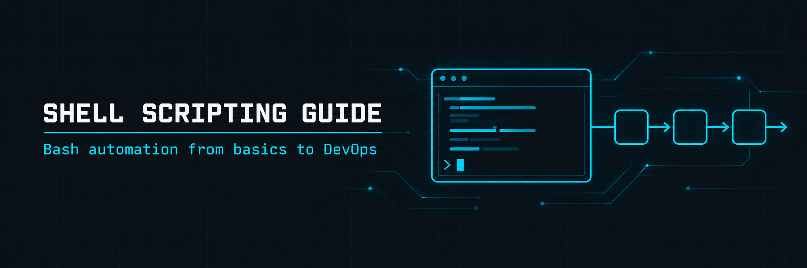

<p align="center">
  
</p>

<h1 align="center">Shell Scripting Complete Guide</h1>

<h3 align="center">Bash scripting from the basics to DevOps automation, with runnable examples</h3>

<p align="center">
  
  
  
  
</p>

<p align="center">
  <a href="#overview"><b>Overview</b></a> ·
  <a href="#topics"><b>Topics</b></a> ·
  <a href="#cheat-sheet"><b>Cheat Sheet</b></a> ·
  <a href="#environment"><b>Environment</b></a> ·
  <a href="#repository-structure"><b>Structure</b></a> ·
  <a href="#resources"><b>Resources</b></a>
</p>

---

## Overview

A practical guide to Bash scripting for automation, system administration and DevOps. It starts with the shebang line and variables, builds up through conditions, loops, functions and error handling, and ends with complete scripts for deployment, health monitoring and backups.

| | |
| --- | --- |
| **Language** | Bash |
| **Format** | One full guide ([`GUIDE.md`](./GUIDE.md)) plus example scripts |
| **Topics** | 13, from basic syntax to real-world DevOps scripts |
| **Practice code** | [`Scripts/`](./Scripts) |

## Topics

| # | Topic | Focus | Key Syntax and Commands |
| - | ----- | ----- | ----------------------- |
| 01 | Basic Foundations | Shebang, executable scripts, comments | `#!/bin/bash` `chmod +x` |
| 02 | Variables | Assignment, special variables, command substitution | `$var` `$0` `$1` `$@` `$#` `$(cmd)` |
| 03 | User Input and Arguments | Prompts, hidden input, script arguments | `read -p` `read -s` `$#` |
| 04 | Conditions and Logic | If/else, file tests, string and number comparison | `if` `[ ]` `[[ ]]` `-eq` `-gt` `-f` `-d` |
| 05 | Loops | Iterating over numbers, files, lists and lines | `for` `while` `read -r` |
| 06 | Functions | Reusable blocks, local variables, return codes | `local` `return` `$1` |
| 07 | Error Handling | Strict mode, traps, dependency checks | `set -euo pipefail` `trap` `command -v` |
| 08 | File and Text Processing | Redirection, pipes, searching and transforming | `grep` `sed` `awk` `cut` `sort` `uniq` `wc` |
| 09 | System Administration | Monitoring, users, services | `df` `free` `ps` `ss` `useradd` `systemctl` |
| 10 | Security and Hardening | Input validation, temp files, permissions, logs | `mktemp` `chmod` `grep` |
| 11 | Advanced Concepts | Arrays, case menus, background jobs | `case` `&` `wait` `kill -0` |
| 12 | Real-World DevOps Use Cases | Deployment, health monitoring, backup rotation | `git pull` `tar` `find -mtime` `mail` |
| 13 | Best Practices | Script template, logging, argument parsing | `case` `shift` `trap cleanup EXIT` |

## Cheat Sheet

| Task | Command |
| ---- | ------- |
| Make a script executable | `chmod +x script.sh` |
| Run a script | `./script.sh` |
| Stop on errors | `set -euo pipefail` |
| Read input from the user | `read -p "Name: " name` |
| Check that a file exists | `[ -f "$file" ]` |
| Check that a command exists | `command -v git &> /dev/null` |
| Loop over files | `for f in *.txt; do ... done` |
| Read a file line by line | `while IFS= read -r line; do ... done < file` |
| Count matching lines | `grep -c "ERROR" file.log` |
| Run a job in the background | `command &` then `wait $!` |
| Clean up on exit | `trap cleanup EXIT` |

## Environment

- Linux with bash 4 or newer (Kali, Debian, Ubuntu and similar)
- A terminal and a text editor
- [ShellCheck](https://www.shellcheck.net/) is recommended for checking your own scripts

Some examples use `sudo`, `systemctl`, `mail` and `bc`, and the deployment and backup scripts write to system paths. Use a virtual machine and change the paths before running them.

## Repository Structure

```
shell-scripting-complete-guide/
├── README.md
├── GUIDE.md                  # full guide, all 13 topics
├── images/                   # banner
└── Scripts/                  # example scripts
```

## Resources

- [Bash Reference Manual](https://www.gnu.org/software/bash/manual/): complete Bash reference
- [POSIX Shell Standard](https://pubs.opengroup.org/onlinepubs/9699919799/utilities/V3_chap02.html): portable shell syntax
- [Advanced Bash-Scripting Guide](https://tldp.org/LDP/abs/html/): long-form tutorial
- [ShellCheck](https://www.shellcheck.net/): static analysis for shell scripts
- [ExplainShell](https://explainshell.com/): breaks a command into its parts

## License

Shared for educational reference.

## Contact

<p align="center">
  <b>Abdul Wahid</b>
</p>

<p align="center">
  <a href="mailto:a.wahid7860668@gmail.com"></a>
  <a href="https://www.linkedin.com/in/abdul-wahid022"></a>
  <a href="https://github.com/abdul-wahid022"></a>
</p>
